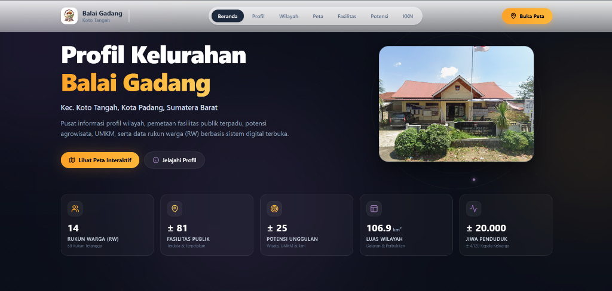

# 🌾 Web Profil & Sistem Informasi Spasial Kelurahan Balai Gadang

  <strong>Pusat Informasi Digital, Pemetaan Fasilitas Publik, Potensi Agrowisata & UMKM</strong> 
  Kelurahan Balai Gadang, Kecamatan Koto Tangah, Kota Padang, Sumatera Barat

---

### 🌐 [Kunjungi Web Balai Gadang (Live Demo)](https://balai-gadang.vercel.app/)

 

  

 

## 📖 Tentang Proyek

Platform web ini dikembangkan sebagai portal informasi terintegrasi dan sistem pemetaan spasial (WebGIS) untuk **Kelurahan Balai Gadang**, Kecamatan Koto Tangah, Kota Padang. Proyek ini mendokumentasikan data kewilayahan, potensi ekonomi lokal, serta sarana-prasarana umum secara transparan, akurat, dan mudah diakses oleh warga masyarakat maupun pemangku kepentingan.

Inisiatif ini dirancang dan diimplementasikan bersama program **Kuliah Kerja Nyata (KKN) Universitas Ibnu Sina Batam (UISB)** untuk mempercepat digitalisasi informasi desa/kelurahan berbasis data terbuka (*open data*).

---

## ✨ Fitur Unggulan

| Fitur | Deskripsi |
| :--- | :--- |
| 🗺️ **Peta Interaktif Spasial (GIS)** | Visualisasi batas wilayah administratif (GeoJSON), layer zonasi RW, serta penanda titik lokasi fasilitas publik dan potensi lokal dengan detail koordinat presisi. |
| 🏛️ **Profil Wilayah & Statistik** | Ringkasan data demografi, luas wilayah (106.9 km²), data 14 Rukun Warga (RW) / 58 RT, dan estimasi kependudukan lebih dari 20.000 jiwa. |
| 📍 **Direktori Fasilitas Publik** | Katalog terstruktur 81+ fasilitas umum (sarana ibadah, pendidikan, sarana kesehatan, pos keamanan, dan kantor pemerintahan) dilengkapi foto, alamat, dan nomor kontak. |
| 🌾 **Katalog Potensi Unggulan & UMKM** | Direktori 25+ potensi lokal yang mencakup agrowisata, perkebunan/pertanian, sentra kuliner, dan kerajinan warga. |
| 🔍 **Pencarian Cepat & Filter Multi-Kategori** | Filter data dinamis berdasarkan kategori, nama lokasi, dan pembagian wilayah RW secara real-time tanpa reload halaman. |
| 📱 **Responsif & Desain Modern** | Antarmuka adaptif untuk perangkat mobile, tablet, maupun desktop dengan efek transisi halus menggunakan Framer Motion. |
| 👥 **Informasi Tim KKN** | Bagan struktur organisasi dan daftar pelaksana pengabdian mahasiswa KKN UISB di Kelurahan Balai Gadang. |

---

## 🛠️ Arsitektur & Teknologi

Website ini dibangun menggunakan stack frontend modern yang mengutamakan performa cepat dan kemudahan pemeliharaan data:

- **Frontend Core**: [React 19](https://react.dev/) + [TypeScript](https://www.typescriptlang.org/)
- **Bundler & Build Tool**: [Vite 6](https://vitejs.dev/)
- **Styling**: [Tailwind CSS v4](https://tailwindcss.com/)
- **Peta Spasial**: [Leaflet.js](https://leafletjs.com/) (OpenStreetMap basemap & custom GeoJSON polygons)
- **Animasi & Interaksi**: [Motion (Framer Motion)](https://motion.dev/)
- **Ikon**: [Lucide React](https://lucide.dev/)
- **Data Engine**: [PapaParse](https://www.papaparse.com/) (Parsing file CSV dinamis dari folder public untuk kemudahan update data non-developer)
- **Deployment**: [Vercel](https://vercel.com/)

---

## 📊 Manajemen Data

Seluruh data fasilitas, potensi, dan informasi wilayah disimpan dalam format standar terbuka (`.csv` dan `.json`) pada direktori `public/data/`. Anda dapat memperbarui data tanpa perlu mengutak-atik kode logika aplikasi:
1. Edit file `facilities.csv` atau `potentials.csv` menggunakan spreadsheet editor (Excel, Google Sheets, LibreOffice Calc).
2. Simpan kembali dalam format CSV UTF-8.
3. Aplikasi akan secara otomatis membaca dan memperbarui data ketika dimuat kembali.

---

## 🤝 Kontribusi & Kemitraan

Proyek ini terwujud berkat kolaborasi antara:
- **Pemerintah Kelurahan Balai Gadang**, Kec. Koto Tangah, Kota Padang.
- **Tim KKN Universitas Ibnu Sina Batam (UISB)**.
- **Masyarakat & Penggerak UMKM Kelurahan Balai Gadang**.

Untuk masukan, pelaporan bug, atau kontribusi fitur baru, silakan buka [Issue](https://github.com/notbell1/balai-gadang/issues) atau ajukan [Pull Request](https://github.com/notbell1/balai-gadang/pulls).

---

## 📄 Lisensi

Didistribusikan di bawah Lisensi [MIT](LICENSE). Terbuka untuk pengembangan lanjutan dan kebermanfaatan publik.

  Dibuat dengan ❤️ untuk kemajuan Kelurahan Balai Gadang, Kota Padang.

